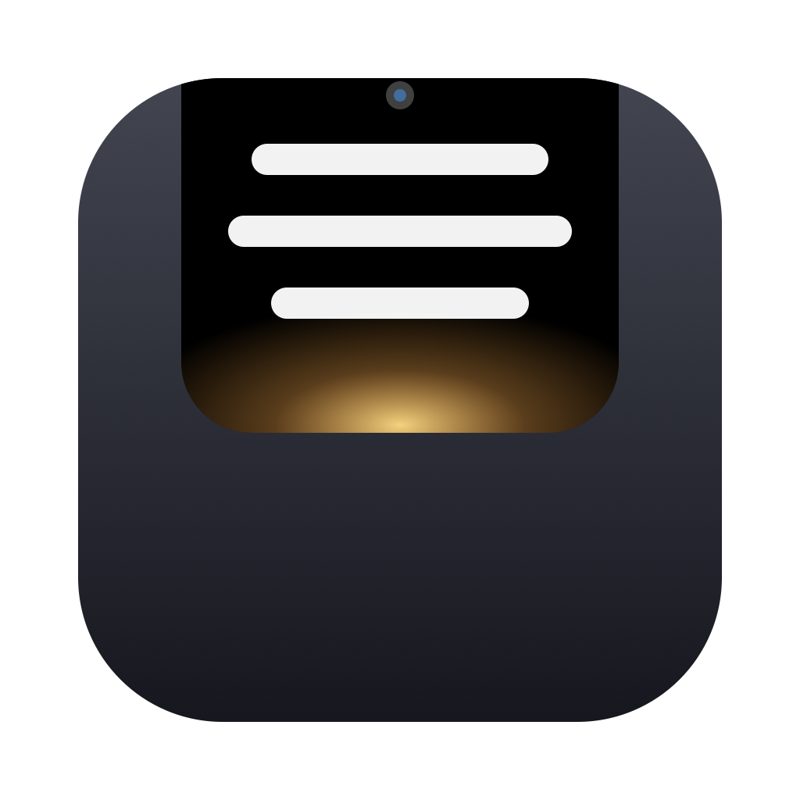
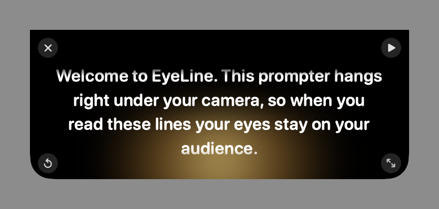

<p align="center"></p>

<h1 align="center">EyeLine</h1>

<p align="center">A teleprompter that hangs from your MacBook's notch, right under the camera,<br>so you read your script while looking your audience in the eye.</p>

<p align="center">
  <a href="https://github.com/byteKumar/EyeLine/releases/latest/download/EyeLine.dmg"><b>Download for macOS</b></a> ·
  <a href="https://bytekumar.github.io/EyeLine/">Website</a>
</p>

<p align="center"></p>

## What it does

- **Sits under your camera.** A black panel that grows out of the notch, so your eyes stay next to the lens while you read.
- **Only you can see it.** The window asks macOS to keep it out of screen capture, so screen shares, screenshots and recordings show your screen without it. Flip one switch if you want it visible for a demo. (Do a quick test call with your meeting app before a big presentation.)
- **Voice glow.** A warm light at the bottom rises while you speak and fades when you're quiet. The mic is used for loudness only; nothing is recorded or sent anywhere.
- **Scrolls at your pace.** Set a speed, or turn on *Scroll only while I'm speaking* and it waits for you.
- **Resizable.** Drag the corner handle; it stays centered on the camera.
- Click the text to pause, scroll on it to rewind, hover for controls. Lives in the menu bar, never steals focus from the app you're presenting.

Works on any Mac running macOS 14 or later. On Macs without a notch it hangs from the top of the screen.

## Install

1. Download [`EyeLine.dmg`](https://github.com/byteKumar/EyeLine/releases/latest/download/EyeLine.dmg), open it and drag EyeLine to Applications.
2. The current build is not notarized, so the first launch is blocked. Open **System Settings > Privacy & Security** and click **Open Anyway**. (Or run `xattr -dr com.apple.quarantine /Applications/EyeLine.app`.)
3. Allow microphone access for the voice glow.

## Build from source

Needs Xcode or the Command Line Tools (Swift 5.9+).

```bash
./scripts/test.sh        # unit tests
./scripts/build-app.sh   # dist/EyeLine.app, EyeLine.zip, EyeLine.dmg (universal)
open dist/EyeLine.app
```

Handy flags: `EyeLine --snapshot out.png [level] [offset]` renders the prompter to a PNG, `EyeLine --mic-test` prints microphone levels for five seconds.

### Signed and notarized builds

With an Apple Developer ID the build script signs with the hardened runtime and notarizes:

```bash
xcrun notarytool store-credentials eyeline --apple-id you@example.com --team-id TEAMID
SIGN_ID="Developer ID Application: Your Name (TEAMID)" NOTARY_PROFILE=eyeline ./scripts/build-app.sh
```

## Releases

Pushing a tag like `v1.0.1` runs [the workflow](.github/workflows/release.yml): tests, a universal build, and a GitHub release with `EyeLine.dmg` and `EyeLine.zip`. The download links above always point at the latest release.

## How it works

| Piece | File |
| --- | --- |
| Floating panel above the menu bar, hidden from capture (`sharingType = .none`) | [PrompterPanel.swift](Sources/EyeLine/PrompterPanel.swift) |
| Prompter UI, glow, controls | [PrompterView.swift](Sources/EyeLine/PrompterView.swift) |
| Scroll timer and settings | [PrompterModel.swift](Sources/EyeLine/PrompterModel.swift) |
| Microphone loudness via `AVAudioEngine` | [MicMonitor.swift](Sources/EyeLine/MicMonitor.swift) |
| Pure math (levels, scrolling, geometry), unit tested | [PrompterMath.swift](Sources/EyeLineCore/PrompterMath.swift) |

## License

MIT
